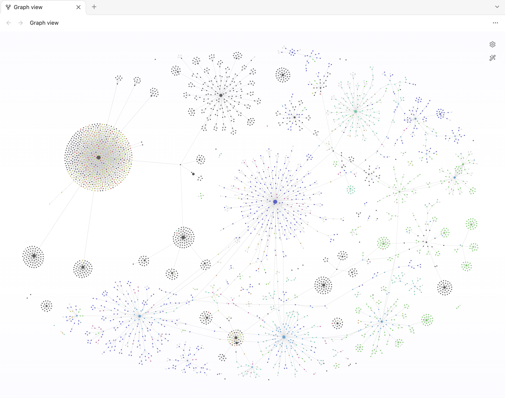

# Graph Squeeze

Give your Obsidian graph more room to spread sideways. Two invisible horizontal force areas gently push nodes inward from above and below.



## Install

Desktop only.

### Community plugins

Open the [Community Directory listing](https://community.obsidian.md/plugins/graph-squeeze) and select **Add to Obsidian**. If it is not available in your app yet, use manual installation below.

### Manual installation

1. Download `main.js` and `manifest.json` from the [latest release](https://github.com/RenWuJun/obsidian-graph-squeeze/releases/latest) and place them in your vault’s `.obsidian/plugins/graph-squeeze/` folder.
2. Reload Obsidian and enable **Graph Squeeze** in **Settings → Community plugins**.
3. Open a global or local graph. Adjust the squeeze in **Settings → Graph Squeeze**.

## Settings

| Setting | Default | Range / behavior |
| --- | --- | --- |
| Barrier distance | 80,000 | Gap between barriers; 0–80,000 graph units |
| Edge softness | 10,000 | Distance from zero to full force; 0–40,000 graph units, limited to half the gap |
| Maximum barrier force | 10 | Push strength; 0–1,000. Zero disables the push |
| Barrier force visualizer | Off | Shows force areas; weaker force is more transparent |

Reduce the barrier distance for a narrower band. Increase softness for a gentler transition. Nodes can move beyond the soft boundaries.

## Compatibility

Uses private Obsidian graph internals, so Obsidian updates may require a plugin update. Patches an in-memory copy of the local graph worker; no application files are modified.

## Privacy

The plugin reads Obsidian’s bundled `sim.js` outside your vault through the local `app://` protocol to add the barrier forces. The scanner counts this `fetch` call as a network request, but it contacts no remote service and sends no notes or other data over the internet. No telemetry is collected.

## Build

```sh
npm ci
npm run lint
npm run package
```

Output: `dist/graph-squeeze/`.

[MIT License](LICENSE)
